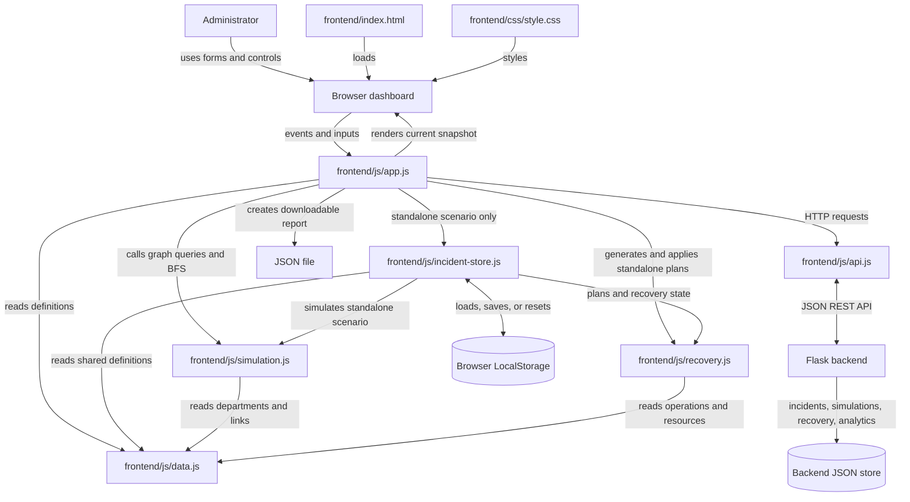

# OMNIS-X

**A01 — A College That Cannot Afford a Single Operational Failure**

OMNIS-X is a browser-based prototype of a college operations command center. It models departments and their dependencies, traces simulated service disruptions, checks recovery options against resource constraints, and summarizes incident and recovery activity.

## Problem statement

College operations depend on connected services: for example, laboratories need electricity, teaching staff, and academic schedules. A failure in one area can disrupt other departments. Administrators need a way to see these relationships, explore possible cascading effects, and review recovery options before deciding what to do.

## Proposed solution

OMNIS-X provides a small institutional digital-twin model using predefined department, dependency, operation, and resource data. A queue-based breadth-first search (BFS) follows dependency links after a selected failure. A rule-based recovery engine then checks alternative resources for availability, capacity, compatibility, and existing allocations.

This is a demonstration prototype. It does not connect to college systems and does not use artificial-intelligence prediction.

## Key features

- Command-center summary of department status, active incidents, and institutional health.
- Interactive SVG dependency network showing upstream and downstream relationships.
- BFS cascading-failure simulations with direct, indirect, and total impact.
- Incident records with separate simulations, status, history, and recovery state.
- Constraint-checked recovery options, rejection reasons, and before/after comparisons.
- Shared resource reservations to prevent the same backup resource being assigned to separate scenarios.
- Institutional and incident analytics, including status and severity summaries, impact counts, and recovery activity.
- Downloadable JSON report built from the current browser state.
- **Reset Demo** control that confirms before clearing only the standalone browser scenario.
- Responsive dark dashboard styled for desktop and smaller screens.

## Technologies

- HTML5 for the dashboard structure and forms.
- CSS3 for the responsive dark theme and CSS-based analytics bars.
- Vanilla JavaScript using native ES modules.
- SVG for the interactive dependency network.
- Flask JSON API for shared incident, simulation, recovery, and analytics persistence.
- Browser LocalStorage for standalone scenarios only.
- Browser Blob/download APIs for JSON report export.
- Visual Studio Code Live Server (or another static HTTP server) for local development.

There are no frontend frameworks or external chart libraries. Incident management requires the local Flask backend.

## Project structure

```text
./
├── .gitignore
├── README.md
├── frontend/
│   ├── index.html
│   ├── css/
│   │   └── style.css
│   └── js/
│       ├── app.js
│       ├── api.js
│       ├── data.js
│       ├── incident-store.js
│       ├── recovery.js
│       └── simulation.js
└── backend/
    ├── app.py
    ├── requirements.txt
    ├── README.md
    ├── app/
    │   ├── __init__.py
    │   ├── data/incidents.json
    │   ├── models/catalog.py
    │   ├── routes/api.py
    │   └── services/
    └── tests/
```

## The 12 modeled departments

Department names, descriptions, baseline statuses, and priorities are defined in `frontend/js/data.js`.

| Department | Modeled responsibility |
| --- | --- |
| Academic Management | Programs, timetables, and academic delivery. |
| Faculty Management | Faculty availability and teaching assignments. |
| Student Services | Student records, advising, and campus services. |
| Laboratories | Practical teaching spaces and lab equipment. |
| Classrooms | Teaching spaces and classroom equipment. |
| Examinations | Examination schedules, venues, and records. |
| Transportation | Student and staff campus transport. |
| Hostels | Residential accommodation and student support. |
| Placements | Employer engagement and placement activity. |
| Events | Institutional events and campus gatherings. |
| Infrastructure | Campus utilities, facilities, and core systems. |
| Administration | Institutional administration and approvals. |

Electricity and Internet are modeled as services provided by Infrastructure, not as additional departments. Resource capacities, availability, and department statuses are sample values.

## Dependency graph and cascading failures

Each dependency is a directed relationship with an upstream provider and a downstream department that relies on it. Examples include:

- Faculty Management supporting Academic Management, Laboratories, and Examinations.
- Academic Management providing schedules to Classrooms, Laboratories, and Examinations.
- Infrastructure providing electricity to Classrooms and Laboratories, and Internet to Placements and Administration.
- Student Services supporting academic, residential, placement, examination, and transport operations.
- Classrooms providing venues used by Examinations; Transportation supporting Events.

The SVG network draws arrows from upstream providers to downstream dependents. Selecting a department highlights its direct links and displays its direct dependencies and dependents. Infrastructure service scenarios can filter the first traversal step to Electricity or Internet.

### BFS failure propagation

`simulateFailure()` in `frontend/js/simulation.js` starts at the selected failed department and uses a queue to visit downstream links breadth-first. A visited set ensures each department is processed once, including when a path contains a cycle. The result includes:

- The initial failure.
- Directly affected departments (one link away).
- Indirectly affected departments (further downstream).
- The propagation order and relationship details.
- Total affected departments, including the initial failure, impact percentage, and a rule-based severity.

The demo severity thresholds are **critical** at 50% or more of modeled departments affected, **high** at 25–49.9%, **medium** at 10–24.9%, and **low** below 10%. These thresholds explain the displayed result; they are not real-world risk predictions.

## Constraint-based recovery engine

`frontend/js/recovery.js` evaluates affected modeled operations against the resource catalog in `frontend/js/data.js`. A recovery assignment must satisfy:

- Resource availability and status.
- Total capacity and currently available capacity.
- Compatibility with the operation.
- The operation's full resource demand.
- Existing allocations and unavailable resources.

If one resource is not sufficient, the engine can evaluate compatible resource bundles. It returns feasible plans separately from rejected options and unresolved operations. Plans include a ranking explanation based on affected operations restored, priority, resource availability, capacity satisfaction, and estimated recovery time. Plan generation is bounded to 16 bundles per requirement and 8,000 combined-plan search states.

Applying a plan checks its constraints again and creates a new recovery state; it does not change the original resource catalog. The comparison reports simulated before/after health, affected and restored departments, unavailable resources, and consumed resources. A restored operation does not imply that every affected department or operation has been restored.

## Multiple incidents, analytics, and reporting

The Incident Management form records a department, failure type, severity, description, timestamp, and active/resolved status; the backend assigns each ID. A new incident receives its own BFS result. Existing backend records load on startup, and a fresh backend store starts with an empty incident history. The frontend sample incidents are not uploaded automatically. Separate incident records keep their own simulations and recovery plans rather than replacing one another.

Backend-managed incidents, their simulations, recovery plans, allocations, and analytics are loaded from the Flask API. Recovery allocations are shared across backend incidents, so a resource reserved by one incident cannot be reused by another. Resolving an incident keeps it in backend history and excludes it from active status; clearing a record removes the incident's associated allocations and activity. The standalone scenario tool remains browser-local and is saved in LocalStorage under `omnis-x-demo-state-v1`. Local demo incidents are not uploaded to the backend.

Institutional Analytics is derived from the current incident records and recovery activity. It shows incident totals and status, severity distribution, direct and indirect impact counts, most affected departments, recovery plans generated and applied, operations restored, resources consumed, department statuses, and current institutional health. Impact totals count affected departments per incident simulation; they are not counts of unique people or real-world events.

**Export JSON report** downloads a snapshot of the current application data. The report contains an export timestamp and simulated-data disclaimer, current department status and health, incident records and impact results, affected departments, recovery activity and allocations, and analytics.

## Reset Demo

**Reset Demo** asks for confirmation and resets only the standalone browser scenario. It does not delete backend-managed incidents or release their resource allocations. Use the incident history's **Clear record** action to delete a backend incident and its associated recovery activity. The original source data and resource catalog are not modified.

## Architecture and data flow

### File responsibilities

- **`frontend/index.html`** — Dashboard markup, forms, metric containers, analytics panels, and the SVG network element. Loads `./js/app.js` as a module and `./css/style.css`.
- **`frontend/css/style.css`** — Dark responsive presentation, status colors, layout, and CSS-based analytics bars.
- **`frontend/js/data.js`** — Single source of simulated departments, dependency links, incident failure types, resources, recovery operations, and sample incidents.
- **`frontend/js/api.js`** — Central HTTP client for the Flask health, department, incident, simulation, recovery, and analytics endpoints.
- **`frontend/js/simulation.js`** — Validates and queries the dependency graph; runs BFS simulations and produces structured impact results.
- **`frontend/js/recovery.js`** — Validates resource requirements, generates and ranks plans, applies plans to separate recovery state, and calculates recovery comparisons.
- **`frontend/js/incident-store.js`** — Persists the standalone scenario in LocalStorage and supports the existing client-side report builder.
- **`frontend/js/app.js`** — Connects UI events to the API and frontend modules, maintains the standalone scenario, renders department and network views, incident history, recovery results and analytics, and builds/exports the JSON report.

### Module relationships

`app.js` loads backend-owned incident and analytics data through `api.js`; the Flask backend persists those records and recovery allocations in its JSON store. The frontend simulation and recovery modules remain available for the standalone scenario tool, which is persisted locally. The app renders returned results; these modules do not directly manipulate page markup.



## System workflow

1. **Backend setup** — Start the Flask server at `http://127.0.0.1:5000` and serve the frontend at `http://127.0.0.1:5500`.
2. **Incident creation** — A user submits the incident form; the frontend creates the backend record and requests its simulation.
3. **Failure simulation** — Existing backend incidents can be simulated from their cards. The standalone scenario form runs its separate browser-side simulation.
4. **Dependency traversal** — `simulateFailure()` traverses downstream dependency links using BFS and avoids duplicate visits; backend incidents use the corresponding simulation API.
5. **Impact calculation** — Simulation results include direct and indirect impacts, propagation order, affected percentage, and rule-based severity.
6. **Recovery plan generation** — The recovery engine finds modeled operations affected by the result and evaluates alternative resource assignments.
7. **Constraint validation** — Availability, capacity, compatibility, demand, and existing backend allocations determine which options are feasible; rejected and unresolved options retain reasons.
8. **Recovery application** — Applying a feasible plan revalidates it, records backend resource reservations, and updates the before/after comparison. Unresolved work remains affected.
9. **Analytics and reporting** — Backend incident and recovery activity updates dashboard analytics and is included in the existing timestamped JSON report.

### Independent incidents and shared resources

Each backend incident stores its own simulation result, recovery plans, restored operation IDs, and applied plan IDs. Resource allocations are held in the backend's shared ledger, preventing double allocation across backend incidents; clearing an incident releases its allocations. The standalone scenario has separate LocalStorage state and does not reserve backend resources.

## Run locally

### Prerequisites

- Python 3.9 or later.
- Visual Studio Code with Live Server, or another static HTTP server.
- Local ports `5000` (Flask) and `5500` (frontend) available.

### Install and start the backend

From the repository root, create a virtual environment and install the backend requirements:

```powershell
py -m venv .venv
.\.venv\Scripts\python.exe -m pip install -r backend\requirements.txt
.\.venv\Scripts\python.exe backend\app.py
```

Flask listens at `http://127.0.0.1:5000`. Keep that terminal open while using the dashboard.

### Start the frontend

Open the repository root in Visual Studio Code, right-click `frontend/index.html`, and choose **Open with Live Server**. Configure Live Server to use port `5500`; the expected origin is `http://127.0.0.1:5500` (the backend also allows `http://localhost:5500`). The frontend files are kept in `frontend/`, separate from the Flask application in `backend/`.

Serve the frontend over HTTP instead of opening `frontend/index.html` directly with `file://`; browsers restrict ES module imports from local file URLs.

### Run backend tests

From the repository root:

```powershell
Push-Location backend
..\.venv\Scripts\python.exe -m unittest discover -s tests -v
Pop-Location
```

Tests use temporary JSON stores and do not write to `backend/app/data/incidents.json`.

## Backend API

All endpoints are prefixed with `/api`:

| Method | Path | Purpose |
| --- | --- | --- |
| GET | `/health` | Backend health check. |
| GET | `/departments` | Department catalog. |
| GET | `/departments/stats` | Baseline department counts. |
| GET / POST | `/incidents` | List or create incidents. |
| PATCH | `/incidents/{incident_id}/resolve` | Mark an incident resolved. |
| DELETE | `/incidents/{incident_id}` | Remove an incident and associated recovery activity. |
| POST | `/simulations` | Simulate and save an incident's BFS impact. |
| GET | `/simulations/{incident_id}` | Retrieve a saved simulation. |
| GET | `/recovery/{incident_id}` | Read stored recovery information without generating plans. |
| POST | `/recovery/{incident_id}/plans` | Generate and save recovery plans. |
| POST | `/recovery/{incident_id}/apply` | Revalidate and apply a recovery plan. |
| GET | `/analytics/overview` | Institutional and incident analytics. |
| GET | `/analytics/departments` | Department status and restoration analytics. |
| GET | `/analytics/recovery` | Recovery activity and allocation metrics. |
| GET | `/analytics/risks` | Deterministic, rule-based department risk estimates. |
| GET | `/analytics/dependencies` | Dependency reach and catalog-backed single-point analysis. |
| POST | `/analytics/scenarios` | Compare 1–10 hypothetical scenarios without saving incidents. |
| GET | `/analytics/export` | Export a current simulated-data snapshot. |

Request bodies are JSON. Invalid requests return a JSON error object with `status`, `message`, and `code`; unexpected errors do not expose stack traces to clients. The development CORS allowlist includes the default Live Server origins on port `5500`. Set `FRONTEND_ORIGINS` before starting Flask if using a different frontend origin.

## Known limitations and simulated-data disclaimer

- All departments, statuses, dependencies, incident records, resources, capacities, availability, impacts, health scores, and recovery activity are simulated demonstration data. Nothing is obtained from a live college system.
- The application uses predefined graph relationships and rules. It does not provide real-time monitoring, AI prediction, external data ingestion, or validated operational forecasts.
- The model includes only the 12 departments and operations defined in `frontend/js/data.js`. Affected departments without a modeled operation can be identified but do not receive a generated recovery plan.
- Capacities and compatibility rules are simplified examples. A feasible plan means it passes the prototype's modeled constraints, not that it is guaranteed to work in a real institution.
- Standalone scenario LocalStorage is browser- and origin-specific. The backend uses a local JSON file and has no authentication or multi-host storage coordination. Its file lock protects cooperating local processes sharing the same store file.
- The institutional health score is a simple average of modeled department status points (operational = 100, warning = 60, failed or affected = 0, with modeled restoration reflected in the current status). It is an explanatory demo metric, not an institutional KPI.
- Recovery plan search has explicit bounds, so it may not enumerate every possible combination in a larger resource catalog.
- There is no authentication; the local JSON backend is for a single-machine demonstration, not production multi-user operation.
- The Flask entry point binds to `127.0.0.1`, and the frontend API base URL in `frontend/js/api.js` is `http://127.0.0.1:5000/api`. Both refer to the browser visitor's own machine. Deployment therefore requires a supplied backend URL, a backend bind suitable for the hosting environment, a matching CORS origin, and updating the frontend API client. No production URL or deployment is configured by this repository.

Use the dashboard and exported reports as a hackathon demonstration only, not as a source of live operational decisions.
